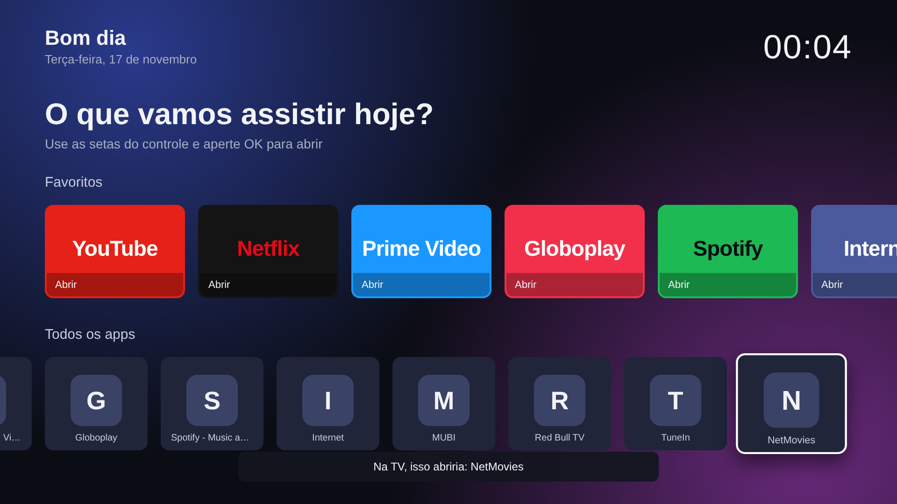

# Novo Home: tela inicial nova para TV Samsung

Uma tela inicial moderna (relógio, saudação, favoritos e todos os apps) feita como app web para TVs Samsung com Tizen. A ideia veio da trend em que as pessoas criam o próprio "launcher" da TV.



## Testar no computador

Abra o `index.html` no navegador. Fora da TV ele usa uma lista de apps de exemplo. Use as setas do teclado e o Enter.

## Instalar na TV

Você vai precisar de um computador na mesma rede Wi-Fi que a TV.

1. **Instale o Tizen Studio** (developer.tizen.org) e, no *Package Manager*, a parte de **TV Extensions** da Samsung.
2. **Ative o modo desenvolvedor na TV:** abra o painel **Aplicativos** (Smart Hub) e digite **1 2 3 4 5** no controle. Ligue o *Developer Mode*, coloque o **IP do computador** e desligue e ligue a TV da tomada.
3. **Conecte o computador à TV:** no Tizen Studio, abra o *Device Manager* → *Remote Device Manager* → **+** e coloque o IP da TV. Para ver o IP, vá em *Rede → Status da Rede* na TV.
4. **Crie um certificado Samsung:** no *Certificate Manager*, crie um perfil do tipo **Samsung** → TV. Ele pede uma conta Samsung e adiciona o DUID da TV automaticamente.
5. **Instale o app:** no Tizen Studio, use *File → Import* → *Tizen Project* e escolha esta pasta. Depois clique com o botão direito no projeto e escolha **Run As → Tizen Web Application**.
   Pela linha de comando, o equivalente é:
   ```
   tizen package -t wgt -s NOME_DO_PERFIL -- .
   tizen install -n "Novo Home.wgt" -t NOME_DA_TV
   ```
6. O app **Novo Home** aparece na lista de apps da TV. Fixe ele na barra do Smart Hub (seta para cima → *Mover*) como primeiro item.

## Personalizar

- **Favoritos, cores e ordem:** lista `FAVORITOS` no começo do `app.js`.
- **Fundo, tamanhos e animações:** `style.css`.

## Limites (seja realista)

- A Samsung **não deixa trocar a tela Home oficial**. O botão Home do controle continua abrindo o Smart Hub. O Novo Home é um app que você abre, de preferência deixado em primeiro lugar na barra.
- TVs de **2015** (como a sua) usam um navegador bem antigo. Por isso o código é escrito em JavaScript ES5 e CSS com prefixos. Os guias da trend foram feitos para TVs de 2016 em diante, então algumas coisas podem se comportar diferente na sua.
- Alguns apps do sistema podem não abrir pelo launcher ("launch failed"). Os ícones dependem do que a TV fornece; quando não há ícone, aparece a inicial do nome.
- O certificado de desenvolvedor expira. Quando o app parar de abrir, gere o pacote e instale de novo.
